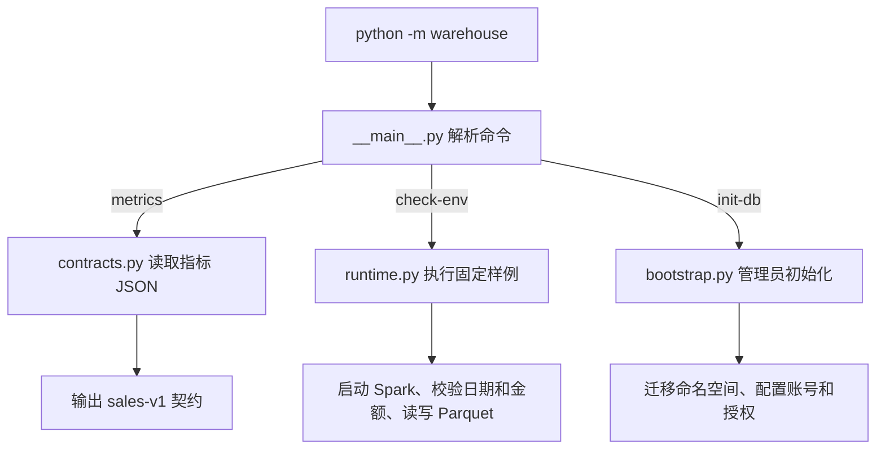
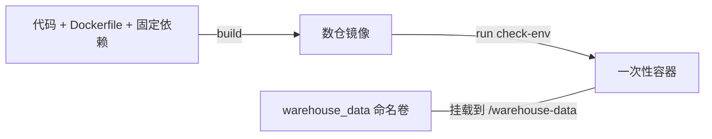
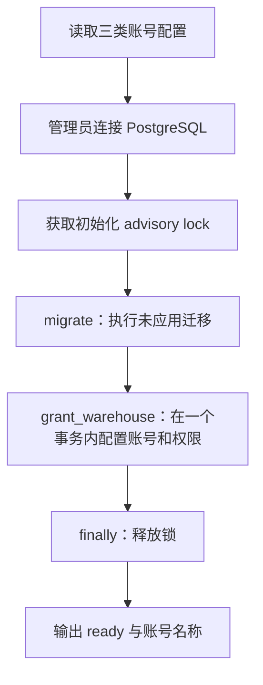

# 第八阶段前两步：实现讲解

本篇对应 `codex/warehouse-stage8` 分支中已经完成的指标口径和独立运行环境。
[阶段说明](08_offline_sales.md)用于查指标、命令和权限，本篇按代码的实际执行顺序解释它们如何配合。

## 1. 当前程序已经能做什么

当前有三个可执行入口：

| 命令 | 解决的问题 | 实际执行内容 |
|---|---|---|
| `metrics` | 后续销售统计应该遵守什么规则？ | 读取指标契约并输出 JSON |
| `check-env` | 本机容器能否正确运行 Spark 和处理目标数据类型？ | 使用两条固定样例执行计算和文件往返 |
| `init-db` | 谁可以访问业务数据和未来的数仓结果？ | 执行未应用迁移，创建或配置三类数据库账号 |

这三条路径分别准备规则、计算环境和访问权限。当前还没有从业务库抽取数据，也没有销售事实表、日报汇总表或正式报表。
例如，`metrics` 输出的 `paid_amount` 是指标名称与公式说明，不是查出来的一笔销售金额。



入口代码见 [warehouse/__main__.py](../../warehouse/__main__.py)。`argparse` 限定了当前三个子命令，输入尚未实现的 `run`、`replay` 或 `report` 会被拒绝。
`runtime` 只在执行 `check-env` 时导入，管理员初始化也只在对应分支导入，因此查看指标和初始化账号不需要先启动 Spark。

## 2. 指标规则如何变成可共用的契约

### 从一个订单确定三种数量

假设订单 O1 购买了两张票，价格分别为 100 元和 120 元：

| 层次 | 数据的含义 | 数量或金额 |
|---|---|---:|
| 订单 | O1 是一次订单 | 1 单 |
| 票券 | T1、T2 各代表一张已售票 | 2 张 |
| 价格明细 | 两张票各自保存下单价 | 100.00 + 120.00 |

后续销售事实一行对应一个 `ticket_id`，所以汇总时票数按行计数，订单数按 `order_id` 去重，金额对两行的 `unit_price` 求和。
如果把订单总额 220 元复制到两行再相加，就会得到错误的 440 元。先确定票级粒度，正是为了避免这种重复计算。

### JSON 保存约定，Python 负责读取

规则集中在 [sales_metrics.json](../../warehouse/contracts/sales_metrics.json)，其中声明了：

- 契约版本 `sales-v1`。
- 票级事实粒度和 `paid_date × session_id` 汇总粒度。
- 业务时间字段 `booking_order.paid_at`，以及上海业务时区。
- 三个指标、成功条件、退款后保留原销售、零金额票等规则。
- 允许作为来源的七张业务表。

[contracts.py](../../warehouse/contracts.py)的核心实现很小：

```python
def sales_contract():
    return json.loads(CONTRACT_PATH.read_text(encoding="utf-8"))

SOURCE_TABLES = tuple(sales_contract()["source_tables"])
```

`metrics` 命令调用 `sales_contract()` 展示规则；账号初始化使用 `SOURCE_TABLES` 逐表授予读取权限。
这样，指标来源和授权名单共用一份定义。后续抽取模块也应使用这份名单。

JSON 中的 `formula` 和 `success_condition` 当前是说明文字，程序不会自动把它们转换为 SQL，也尚未校验真实销售数据。
第三步以后的抽取、Spark SQL 和对账代码必须把这些约定落实为实际逻辑。

### 为什么已经退款的票仍然属于原销售

当前指标统计历史上发生过的成功销售。退款会改变订单和票的当前状态，但没有抹去此前的支付和出票事件。
因此契约明确要求保留原销售，不能只选择 `VALID` 票或当前仍为 `PAID` 的订单。
后续再用独立退款事实解释退了多少，以及支付减退款后还剩多少。

## 3. 独立镜像与 Compose 如何组织运行

### 一套代码，两个镜像环境

| 镜像 | 构建文件 | 运行时能力 |
|---|---|---|
| 购票应用/管理员镜像 | [Dockerfile](../../Dockerfile) | 现有应用依赖，加上轻量数仓代码与契约 |
| 数仓镜像 | [docker/warehouse.Dockerfile](../../docker/warehouse.Dockerfile) | Python、Java、PySpark、PyArrow 和 Psycopg |

Java 用于运行 Spark JVM，PySpark 提供 Python 接口，Py4J 连接 Python 和 JVM，PyArrow 用于构造明确类型的表并读写 Parquet，Psycopg 用于 PostgreSQL 连接。
这些数仓依赖固定在 [requirements-warehouse.txt](../../requirements-warehouse.txt)，不并入购票应用的依赖文件。

数仓 Dockerfile 依次安装 Java、建立 `warehouse` 用户与数据目录、安装 Python 依赖、复制代码，最后切换到 UID/GID `10001:10001` 运行。
创建带主目录的真实用户，可以让 Java 正确定位用户缓存目录；只写一个数字 UID 时，本项目首次检查曾遇到主目录被识别为 `?` 的启动问题。

镜像默认入口为：

```dockerfile
ENTRYPOINT ["python", "-m", "warehouse"]
CMD ["--help"]
```

所以向该镜像传入 `check-env`，最终执行的就是 `python -m warehouse check-env`。

### Compose 中的两个服务

[compose.yaml](../../compose.yaml)定义了两个按需服务：

- `warehouse` 使用 Spark 镜像，接收 reader、writer 密码，挂载数据卷。它没有依赖数据库自动启动，因而可以单独检查计算环境。
- `warehouse-admin` 复用应用镜像，把入口改为 `python -m warehouse`，默认参数设为 `init-db`，并等待 PostgreSQL 健康后执行。它负责需要管理员权限的初始化。

二者均属于 `warehouse` profile。普通购票服务启动时，不会因此多启动一个常驻 Spark 进程。
普通 `warehouse` 容器没有接收数据库管理员密码或 reporter 密码。

`local[2]` 表示本地 Spark 使用两个任务执行线程，不表示有两台服务器。当前 driver、JVM 和按需创建的 Python worker 都运行在同一个容器内。

### 镜像、容器和数据卷分别保存什么



镜像保存构建时的程序和依赖，容器负责一次运行，命名卷承载需要跨容器保存的数据。
`run --rm` 删除本次容器，不删除命名卷；当前检查只在卷内创建临时目录，完成后会清理自己的样例文件，因此卷里还没有业务 ODS 数据。

## 4. check-env 如何证明环境真的能运行

实现见 [warehouse/runtime.py](../../warehouse/runtime.py)。它使用固定样例，不读取业务数据库。

### 先固定运行参数和输入类型

程序先检查 `java -version`，再建立 SparkSession，明确设置：

| 参数 | 目的 |
|---|---|
| `master('local[2]')` | 在一个容器里执行本地并行任务 |
| `spark.sql.session.timeZone=UTC` | 为时间读写建立统一基础 |
| `spark.sql.parquet.outputTimestampType=TIMESTAMP_MICROS` | 明确输出时间戳精度 |
| `spark.sql.shuffle.partitions=2` | 小样例使用较少的分组分区 |
| `spark.driver.host/bindAddress=127.0.0.1` | 本地 driver 使用回环地址 |
| `spark.ui.enabled=false` | 不启动此检查不需要的 Spark UI |

PyArrow 输入 schema 明确规定 `id` 为 int64、`event_at` 为带 UTC 时区的微秒时间戳、`amount` 为 DECIMAL(18,2)。
金额用 `Decimal('100.10')` 这样的字符串构造，避免先经过浮点数。

固定输入只有两行：

| id | event_at，UTC | amount | 期望的上海日期 |
|---|---|---:|---|
| 1 | 2026-11-03 15:59:00+00 | 100.10 | 2026-11-03 |
| 2 | 2026-11-03 16:00:00+00 | 0.00 | 2026-11-04 |

### 按实际数据路径执行检查

1. PyArrow 把两行写入 `input.parquet`。
2. Spark 读取该文件，执行 `to_date(from_utc_timestamp(..., 'Asia/Shanghai'))`，校验两个日期。
3. Spark 对金额求和，校验结果是 `Decimal('100.10')`，而不是 float。
4. 执行 Python worker 的 `map`，确认 Python 任务真正运行。
5. Spark 写出另一个 Parquet 目录，再由 PyArrow 读取。
6. 读回结果按 `id` 排序并转换到预期 schema，再逐值比较。

其中 worker 检查是：

```python
spark.sparkContext.parallelize([1, 2], 2).map(lambda n: n * 2).collect()
```

它应得到 `[2, 4]`。只启动 SparkSession 并不能证明 Python worker 可用，这个实际 action 补上了验证。
Parquet 比较验证的是类型统一后的字段值，不要求不同工具写出的文件逐字节一致。

样例位于 `TemporaryDirectory`，结束时删除；成功建立的 SparkSession 在 `finally` 中停止。
通过后输出 `status=passed`、实际组件版本和检查项目，方便核对运行的环境。
CI 使用 `--network none --hostname localhost` 运行同一检查；localhost 使无外部网络时的 Java 主机名解析仍然成立。

## 5. init-db 如何建立命名空间与权限

入口为 [warehouse/bootstrap.py](../../warehouse/bootstrap.py) 的 `initialize()`。



### 配置与锁先于授权

[config.py](../../warehouse/config.py)从环境变量读取账号和密码。三类密码缺失或为空时，程序先报错，不开始迁移。
`Role` 使用 `repr=False` 隐藏对象打印中的密码，这只减少意外输出，并不表示密码被加密保存。
修改 `.env` 也不会自动修改数据库密码，需要重新运行管理员初始化来应用。

管理员取得 `pg_advisory_lock(782314, 8)`，使使用同一把锁的数仓初始化命令串行运行；退出路径用 `finally` 释放。
这把锁管理初始化命令，不用来锁住购票订单。

### 006 为什么可以重复初始化

[006 迁移](../../migrations/006_warehouse_foundation.sql)只创建三个 schema，并撤销 PUBLIC 对它们的默认访问：

| schema | 预留用途 |
|---|---|
| `wh_meta` | 抽取批次、任务状态和发布元数据 |
| `dws` | 按批次保存的汇总结果 |
| `ads` | 供报表读取的正式结果视图 |

Schema 是同一个数据库中的命名空间，不是三个新数据库；这里也没有新增计算资源隔离。
当前三者为空，图中的“执行迁移”不会创建销售事实或日报数据。

重复执行之所以可行，是因为复用了 [ticketing/bootstrap.py](../../ticketing/bootstrap.py) 的迁移登记机制：

1. 计算迁移文件的 SHA-256。
2. 已在 `schema_migration` 登记且校验值一致，则跳过。
3. 未登记时，将 DDL 和登记记录放在同一事务提交。
4. 已登记文件的内容变化时停止，要求新增迁移。

因此无需靠给每个 `CREATE SCHEMA` 加 `IF NOT EXISTS` 来掩盖结构差异。手工创建了同名 schema 却没有迁移登记时，程序会报冲突。

### 三类账号如何限制能力

`grant_warehouse()` 先要求角色名互不相同，并把三类账号配置放在同一个授权事务内。
对已有账号，它检查项目 COMMENT 标记、超级用户等特权标志，以及是否存在额外角色成员关系；不符合约定就停止。
新账号显式设置 `NOSUPERUSER`、`NOCREATEDB`、`NOCREATEROLE`、`NOREPLICATION`、`NOBYPASSRLS` 和 `NOINHERIT`。

授权分成几个层次：

| 授权 | 解决的问题 |
|---|---|
| 数据库 `CONNECT` | 能否连接目标数据库 |
| schema `USAGE` | 能否在该命名空间中访问对象 |
| 表/视图 `SELECT` 或 DML 权限 | 能否读取或修改具体数据 |
| 序列 `USAGE/SELECT` | 能否使用未来表所需的自增序列 |

Reader 逐表获得契约中七张业务表的 SELECT；writer 获得 wh_meta、dws 的读写；reporter 只获得 ads 的读取。
Writer 没有 schema CREATE 权限，未来建表仍由迁移管理员负责。
这里的账号是 PostgreSQL 登录角色，与网站注册用户不同；购票用户保存在 `app_user` 中，并不会因此各自获得数据库登录权限。
账号与表名通过 `sql.Identifier` 组合，密码通过 `sql.Literal` 处理，避免直接拼接未经引用的 SQL 字符串。

### 为什么还需要默认权限

`GRANT ... ON ALL TABLES IN SCHEMA ...` 处理当前已有对象。由于这些 schema 目前为空，仅执行这句不能授权以后才创建的表。
代码额外设置 `ALTER DEFAULT PRIVILEGES`，为当前初始化管理员以后创建的对象配置权限。
例如，以默认管理员 `ticketing_admin` 为例，writer 的表权限规则相当于：

```sql
ALTER DEFAULT PRIVILEGES FOR ROLE ticketing_admin IN SCHEMA wh_meta, dws
GRANT SELECT, INSERT, UPDATE, DELETE ON TABLES TO ticketing_wh_writer;
```

序列和 ads 读取也有相应规则。这些默认权限只针对指定的对象创建者；换一个账号建表，不会自动套用原创建者的规则。

### 哪些变更会一起回滚

三个账号的创建、密码更新和授权位于 `grant_warehouse()` 的同一个事务。
例如，reader、writer 已经处理，但发现 reporter 是不属于本项目管理的同名账号，前两个账号在本次事务中的变更也会回滚。

迁移与授权不是一个总事务。已经成功提交的 006 迁移，不会因后续授权失败而撤销；修正配置后重试时，迁移登记会让它被跳过。
正常执行时，迁移可能先打印进度消息，最后才打印 `ready` JSON，不能假设首次初始化的整段标准输出只有一个 JSON 对象。

## 6. 如何验证权限确实生效

[test_warehouse_foundation.py](../../tests/python/test_warehouse_foundation.py)继承现有 PostgreSQL 测试夹具，创建独立临时数据库和随机角色。
测试在授权之后才创建探针表、identity 序列和 ADS 视图，因此能检验默认权限是否覆盖未来对象。

| 测试 | 验证内容 |
|---|---|
| Reader 来源读取 | 七张表可查询，认证表、用户资料、业务写入和建表被拒绝 |
| Writer 数据写入 | 可插入、更新、删除新数仓表，含 identity 字段的表可正常生成编号；业务访问和建表被拒绝 |
| Reporter 视图读取 | 可查询管理员拥有的普通 ADS 视图，没有底层表权限也能通过该视图读取；直接访问底层表和写视图被拒绝 |
| 重复初始化 | 角色仍可登录，权限标志符合预期 |
| 冲突回滚 | 模拟未知角色标记，确认整笔授权事务回滚，原密码仍可登录 |

这些验证使用真实 PostgreSQL 连接，让数据库实际接受或拒绝 SQL，而不是只检查 Python 中的权限名单。
类清理按后进先出执行：先删临时数据库，再删随机角色，避免角色仍有对象依赖，也不修改开发库账号密码。

[verify_deployment.py](../../scripts/verify_deployment.py)再用全新临时 Compose 项目检查：迁移、两次管理员初始化、角色权限，以及原有 HTTP 支付、退款、重售和超时清理。
已有的 62 项集成测试与 Spark 检查结果见 [验证记录](../verification/stage8-foundation.md)。这些记录证明前两步可运行，尚未证明未来销售加工的正确性。

## 7. 阅读和运行顺序

建议先按以下顺序对照源码：

1. [指标契约](../../warehouse/contracts/sales_metrics.json)：先理解统计什么。
2. [命令入口](../../warehouse/__main__.py)与[契约加载](../../warehouse/contracts.py)：看一次命令如何分派。
3. [Compose](../../compose.yaml)与[数仓 Dockerfile](../../docker/warehouse.Dockerfile)：看命令在哪个环境运行。
4. [环境检查](../../warehouse/runtime.py)：跟踪两行样例从输入到输出的完整路径。
5. [初始化](../../warehouse/bootstrap.py)、[006 迁移](../../migrations/006_warehouse_foundation.sql)和[权限测试](../../tests/python/test_warehouse_foundation.py)：看权限如何建立、验证和回滚。

可以先运行两个不访问业务库的命令观察结果：

```bash
docker compose --profile warehouse run --rm --no-deps warehouse metrics
docker compose --profile warehouse run --rm --no-deps warehouse check-env
```

`init-db` 会修改命名空间、账号和授权，不是只读检查；部署与备份说明见 [阶段文档](08_offline_sales.md)。

最后区分四种独立保存的状态：

| 状态 | 保存位置 | 切换 Git 分支是否会同时切换 |
|---|---|---|
| 源码、指标契约、Dockerfile | Git 工作树与提交 | 会 |
| 已构建的程序和依赖 | Docker 镜像 | 不会，需要按对应分支重新构建 |
| 数据库 schema、角色、业务记录 | PostgreSQL / pg_data | 不会 |
| 未来的 ODS 等数据文件 | warehouse_data | 不会 |

因此，查看旧源码与运行旧镜像、恢复旧数据库是不同操作。当前阶段没有 ODS 文件，环境检查留下的临时样例也已清理。
