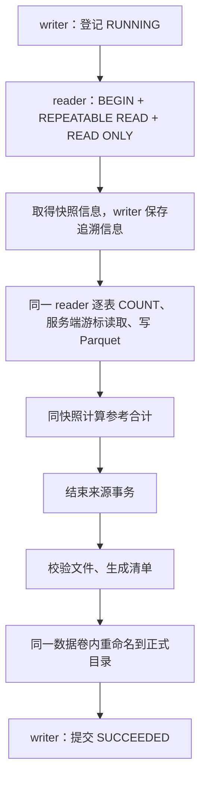

# 第八阶段第三步：七表一致性抽取

本步将业务库中的七张来源表保存为可追溯、可验证的 ODS 原始批次。
当前可以执行 `extract` 和 `verify-batch`；销售事实表、Spark 业务加工、日报和调度仍属于后续步骤。

## 1. 实现由哪些模块组成

| 文件 | 职责 |
|---|---|
| [007 迁移](../../migrations/007_warehouse_extract.sql) | 建立 wh_meta.extract_batch 批次表及状态约束 |
| [schemas.py](../../warehouse/schemas.py) | 定义七张表的列、数据库类型、空值规则、主键和 Arrow 类型 |
| [batches.py](../../warehouse/batches.py) | 用 writer 独立短连接登记批次、更新快照和结束状态 |
| [extract.py](../../warehouse/extract.py) | 在一个来源快照中分批读取，协调文件交付与状态提交 |
| [manifests.py](../../warehouse/manifests.py) | 校验 Parquet 类型、行数、文件散列和清单 |
| [命令入口](../../warehouse/__main__.py) | 解析 extract、verify-batch 参数并输出安全结果 |

使用 Python、Psycopg 和 PyArrow 直接完成搬运，不需要为抽取启动 Spark。
这些工具已经在数仓镜像中；原购票应用镜像不增加 PyArrow 依赖。

## 2. 运行命令

在仓库根目录执行，沿用已有 .env 中的三个数仓密码，不覆盖原配置：

```bash
docker compose up -d --wait postgres
docker compose --profile warehouse run --rm --build warehouse-admin
docker compose --profile warehouse build warehouse
docker compose --profile warehouse run --rm warehouse extract
```

管理员命令应用 007 迁移并配置既有/未来对象权限，普通抽取容器只使用 reader、writer 凭据。
成功输出的 `source_batch_id` 可用于验证：

```bash
docker compose --profile warehouse run --rm warehouse verify-batch --batch <批次UUID>
```

`extract --chunk-size 5000` 控制每次获取的行数，允许 1～100000，默认 5000。小数据演示可以使用 1 来观察多次分批写入。
正常退出码为 0；已处理的错误返回 1 和安全错误码，不输出源记录、密码或原始 SQL 异常。
成功输出包括批次编号、清单相对路径、SHA-256、七表行数和同快照参考合计；verify-batch 还返回 `files_verified=7`。

## 3. 为什么需要两类连接

Reader 用于同一只读快照中的七表数据和参考查询。Writer 用于持久化批次状态，每次操作是独立短连接。
因此即使来源读取失败并回滚，仍然可以记录本次抽取失败；同时不会为记日志而把来源事务改成可写。

批次状态表包含：UUID 主键、契约与 schema 版本、开始/结束时间、快照信息、清单路径与散列、行数、参考合计和错误码。
数据库约束要求 RUNNING 没有结束信息，FAILED 有结束时间与错误码，SUCCEEDED 有快照、结束时间和有效形状的清单散列。
代码更新状态时带有 `WHERE status='RUNNING'`，不会把已经成功的批次重新标记失败。

## 4. 同一个快照贯穿七张表

核心流程如下：



`connect_role()` 当前是 autocommit 连接，抽取函数显式开启事务，先执行：

```sql
SET TRANSACTION ISOLATION LEVEL REPEATABLE READ, READ ONLY;
SET LOCAL statement_timeout='5min';
```

随后调用 `pg_current_snapshot()` 取得快照信息。之后的七表 schema 检查、COUNT、游标和参考 SQL 共用这条连接及事务。
不能每张表新开一个连接，否则不同表可能来自不同时间的状态。

例如，第一张订单表读取后，有人完成支付并提交。当前批次仍看到支付前的订单、支付尝试和票券；下一次新批次才看到支付后的完整状态。
并发测试在两次读表之间真正提交支付，以此验证快照不混合。

快照记录包含数据库名、pg_current_snapshot 的文本和记录时刻，不保存连接密码。
该文本用于诊断，不能在事务结束后凭它恢复数据库快照；记录时刻也不是增量提交水位。
未来重放应读取本次保存的 Parquet，而不是尝试重新打开这次数据库事务。

来源事务只维持到所有数据写完及参考查询结束。文件散列和文件校验在之后执行，以缩短占用来源快照的时间。
5 分钟是每条数据库语句的上限，不是整项任务的总超时。大规模长事务会影响旧版本回收，增量与分区方案需后续评估。

## 5. 类型、流式读取与空表

ODS 保留来源精度：订单/支付金额 NUMERIC(14,2)，明细票价 NUMERIC(12,2)，不先转成 float。
BIGINT 对应 int64；TIMESTAMPTZ 对应 UTC 微秒时间戳；UUID 显式转为字符串；空值保留。

每张表先检查实际列名、基础类型、金额精度和空值声明。与 ods-v1 不符就报 `SOURCE_SCHEMA_MISMATCH`，不静默丢掉新增列。
读取使用明确列名，并按主键升序排序。Psycopg 命名游标每次只取 chunk-size 行，转成 Arrow Table 后交给同一个 ParquetWriter。
这避免把整张表一次性装入 Python 内存；一个小型项目批次中每表先写一个文件。

没有数据时，也写出带明确 schema 的空 Parquet。三种行数必须相等：

```text
同快照 COUNT(*) = Python 实际写入行数 = Parquet 元数据行数
```

原始层不按当前 PAID/VALID 状态筛选。失败支付尝试和退款后的电子票都保存下来，为后续业务建模保留依据。

## 6. 文件布局与清单

```text
/warehouse-data/
├── .staging/<UUID>/                  # 尚未交付
└── ods/<UUID>/
    ├── booking_order/part-00000.parquet
    ├── booking_item/part-00000.parquet
    ├── payment_attempt/part-00000.parquet
    ├── ticket/part-00000.parquet
    ├── activity_session/part-00000.parquet
    ├── activity/part-00000.parquet
    ├── venue/part-00000.parquet
    └── manifest.json
```

每次创建新的 UUID，不覆盖已有批次。临时目录和正式目录都在同一个 warehouse_data 卷中，才能使用本地目录重命名作为文件可见性的切换点。
文件和目录执行 fsync，再提交成功状态；这仍不是数据库和文件系统之间的分布式事务。

清单包含 format_version、extractor_version、sales-v1、ods-v1、来源快照、七表字段结构、相对路径、主键、行数、字节数、文件 SHA-256 和参考合计。
数据库另外保存 manifest.json 的 SHA-256，避免仅依赖文件自己宣称的校验值。
成功批次按代码约定只读；校验值可以检测变化，但文件系统没有被配置为不可修改的 WORM 存储。

参考合计在同一个来源快照中直接计算：成功支付订单数、成功出票数、模拟支付金额。金额在 JSON 中以两位小数字符串保存。
此处保留的是来源侧对照值，还没有生成票级销售事实或每日场次汇总。

## 7. 失败、未知状态与消费规则

后续消费者必须先调用 verify_batch：

1. 数据库中的批次存在且为 SUCCEEDED。
2. 清单路径与该 UUID 的固定目录一致。
3. 清单 SHA-256 与数据库记录一致。
4. 契约、schema、快照、参考合计及七表集合一致。
5. 每个固定路径下的文件不是符号链接，字节数、散列、schema 和行数都正确。

验证不接受清单指向 `../` 或其他任意文件；只读取本版本约定的七个相对路径。

| 出错位置 | 处理 |
|---|---|
| 读取或临时写入失败 | 尝试标记 FAILED，清理本进程创建的临时目录 |
| 正式目录已生成、成功状态提交前失败 | 目录可能保留，但失败批次不可消费 |
| 成功状态已提交，回执丢失 | 重连查到 SUCCEEDED 后验证完整文件，返回成功，不降级或删除 |
| 状态无法查询或确认 | 返回 BATCH_STATUS_UNCERTAIN，保留文件供核对 |
| 强制终止或断电 | 可能留在 RUNNING；不自动视为成功，也不仅凭时间猜测失败 |
| 成功后的文件被改动 | verify-batch 拒绝消费，原成功登记保留为历史记录 |

注册失败也不会修改同 UUID 的既有批次。正式目录不在异常处理中自动删除，避免误删已经交付的数据。
RUNNING 和状态不明确的批次需要核对执行进程、记录和文件后处理；本步没有加入自动回收任务。

常见错误码包括 SOURCE_SCHEMA_MISMATCH、ROW_COUNT_MISMATCH、BATCH_NOT_SUCCEEDED、MANIFEST_CHECKSUM_MISMATCH、FILE_CHECKSUM_MISMATCH 和 BATCH_STATUS_UNCERTAIN。
散列和状态检查针对本步的正常写入流程与损坏检测，不意味着 writer 或文件所有者无法主动篡改记录。

## 8. 测试方式与范围

```bash
docker compose --profile warehouse run --rm --build warehouse-tests
python3 scripts/verify_deployment.py --warehouse
```

warehouse-tests 使用独立 Docker 构建目标，包含 PyArrow 和交易测试夹具；不把这些依赖加入应用镜像。
每个测试类使用随机角色、独立临时数据库，每个用例清理自己的数据与临时文件。
覆盖正常抽取、空表、类型与零金额、失败支付和退款保留、并发支付、重复抽取、UUID 冲突、部分写入失败、重命名后失败、成功回执丢失、未知状态、文件/清单损坏、路径限制、schema 漂移、只读事务和 CLI。

带 --warehouse 的部署验收还在独立 Compose 项目中构建两个数仓目标、运行离线 Spark 检查和抽取测试，再经实际 CLI 抽取两个批次并逐个验证，同时回归既有票务流程。
CI 的 warehouse-environment 作业执行同一入口。本地结果、真实批次编号、原始行数和备份位置见 [第三步验证记录](../verification/stage8-extract.md)。
