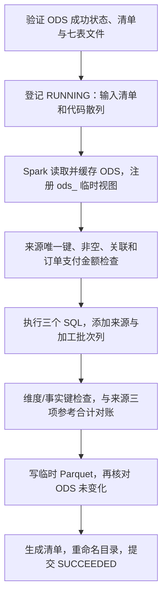

# 第八阶段第四步：Spark 维度与票级销售事实

本步读取第三步已成功保存、校验通过的 ODS 批次，用真实 Spark SQL 生成 dim_date、dim_session、dwd_ticket_sale 三个 Parquet 数据集。
PostgreSQL 新增的是 wh_meta.transform_run 技术表；维度和销售明细当前存于数据卷，还没有加载为 PostgreSQL 业务分析表。
按日汇总、ADS 报表和正式发布指针留到第五步。

## 1. 如何运行

在仓库根目录沿用原 .env，先应用新增的 008 迁移并构建数仓镜像：

```bash
docker compose --profile warehouse run --rm --build warehouse-admin
docker compose --profile warehouse build warehouse
docker compose --profile warehouse run --rm warehouse transform --source-batch <ODS批次UUID>
```

使用 transform 输出的 run_id 校验结果：

```bash
docker compose --profile warehouse run --rm warehouse verify-transform --run <加工run_id>
```

transform 使用 writer 查询技术表、登记任务，读取数据卷中的 ODS 文件，不从业务表重新取数，也不需要 reader 账号连接业务库。
verify-transform 校验登记、来源血缘和输出文件，不启动 Spark JVM。成功时退出码为 0；已处理错误输出安全错误码并返回 1。

## 2. 三张表的粒度与字段

| 数据集 | 本次加工内的唯一键 | 主要字段 |
|---|---|---|
| dim_date | date_key，整数 YYYYMMDD | calendar_date、calendar_year、quarter、month、day_of_month、iso_weekday、iso_week_number、is_weekend |
| dim_session | session_id | 活动编号/名称、场馆编号/名称/地址、主办方编号、开场/结束时间、开场日期与日期键、场次状态 |
| dwd_ticket_sale | ticket_id | item_id、order_id、payment_id、session_seat_id、session_id、user_id、paid_at、paid_date、paid_date_key、sale_quantity、sale_amount |

三张表都附带 source_batch_id 和 transform_run_id。唯一键和维度外键的含义限定在同一加工 run 内；跨 run 读取时必须带上批次条件。

销售金额来自 booking_item.unit_price，输出为 DECIMAL(18,2)，sale_quantity 固定为整数 1。
同一座位可以退款后再次出售，因此 session_seat_id 不能充当销售事实主键。
当前 source 没有结构化渠道、城市和检票信息，本步不推测这些字段。

## 3. 从 ODS 到事实表的实际执行顺序



实现入口是 [transform.py](../../warehouse/transform.py)。
首次验证复用 verify_batch，输入失败或文件损坏时，不登记一个可运行的加工任务。
登记任务还通过 INSERT ... SELECT 检查来源状态和清单散列没有变化。

[spark.py](../../warehouse/spark.py)建立 local[2] SparkSession，明确 UTC、TIMESTAMP_MICROS、两个 shuffle 分区和 ANSI 模式。
ANSI 模式让非法转换、溢出等错误暴露出来，而不是用空值掩盖问题。
程序只收集质量检查的小结果与合计，不把整张销售事实 collect 到 Python。

来源和输出 DataFrame 在本次任务内缓存，结束时 unpersist 并清理临时视图。
CLI 创建的 SparkSession 由任务停止；库调用者传入已有 session 时，由调用者负责最终停止。

## 4. 三份 SQL 分别做什么

### 票级销售事实

[ticket_sale.sql](../../warehouse/sql/ticket_sale.sql)的关联顺序为：

```text
ticket → booking_item → booking_order → 该订单的 SUCCEEDED payment_attempt
```

票与明细不仅匹配 item_id，还匹配 order_id、session_seat_id；明细与订单匹配 order_id、session_id。
只有成功支付且 paid_at 非空的订单生成销售事实。
SQL 不使用订单当前 PAID 状态或票当前 VALID 状态作为筛选条件，因此退款后的原销售仍然保留。

金额取每张票的下单价，不复制整单支付金额。支付时刻保留 UTC；paid_date 和 paid_date_key 通过 from_utc_timestamp 转成上海日期。
例如，UTC 15:59 与 16:00 在上海属于相邻两天。零金额成功票仍生成事实行并计入票数、订单数。

### 场次维度

[dim_session.sql](../../warehouse/sql/dim_session.sql)将 activity_session 与 activity、venue 关联，保留所有来源场次，不根据当前是否开售过滤。
日期键来自上海开场日期，与 dim_date 相连。
名称、地址和状态反映 ODS 采集快照中的描述，不承诺恢复购票当时已经被源系统覆盖的旧名称；本步尚未实现 SCD 历史版本。

### 日期维度

[dim_date.sql](../../warehouse/sql/dim_date.sql)取来源中所有非空支付日和场次开场日的最小/最大日期，在其间生成连续日期。
这样，无成交的中间日期也有日历属性。iso_weekday 为周一 1 到周日 7；iso_week_number 是 ISO 周号，与 calendar_year 的自然年概念分开。
全空 ODS 产生有类型的空日期维度；有场次、无销售时，场次维度和日期维度仍可有行，销售事实为空。

## 5. 怎样避免 JOIN 把错误数据悄悄吞掉

[quality.py](../../warehouse/quality.py)在运行事实 SQL 前检查来源，不靠 dropDuplicates 修正原始数据。

| 检查 | 失败示例/错误码 |
|---|---|
| 七表主键唯一、必填字段非空、Spark 行数与 ODS 一致 | SOURCE_DUPLICATE_KEY、NULL_REQUIRED_FIELD |
| 订单、明细、票、支付、场次、活动和场馆关联完整 | SOURCE_RELATION_MISMATCH |
| 每个明细最多一张票，每单最多一笔成功支付 | MULTIPLE_TICKETS_PER_ITEM、MULTIPLE_SUCCESS_PAYMENTS |
| 成功支付对应非空 paid_at，金额等于订单总额 | MISSING_SUCCESS_PAYMENT、INVALID_SUCCESS_PAYMENT |
| 成功订单明细金额合计等于订单总额 | ORDER_AMOUNT_MISMATCH |
| 成功订单的明细都出票，票不能落在未支付明细上 | MISSING_ISSUED_TICKET、UNPAID_TICKET |

如果先 inner join 再统计，缺父记录的明细可能直接消失。这里先用 left_anti 等检查找出缺关联情况，再允许建立事实表。

输出还检查三表主键、必填值、销售金额非负、数量为 1，以及事实到场次/日期、场次到日期的外键关系。
Spark 会推导物理 Parquet 字段的 nullable，代码在提交前检查实际值非空；清单记录逻辑非空约定，不把它误当作文件系统里的 SQL NOT NULL 约束。

## 6. 三项对账如何执行

Spark 对 dwd_ticket_sale 计算：行数、order_id 去重数、sale_amount 合计。
它们必须逐项等于第三步在同一来源数据库快照中保存的 reference_totals，金额比较使用 Decimal 和两位小数字符串，不经过 float。
空事实的合计为 0 张、0 单、0.00。

例如，一单购买 100、120 两张票，得到 2 行、1 单、220.00。
若整单退款，随后同一批座位以 150、125 再售出，应得到 4 行、2 单、495.00，原销售仍为 220.00。
这也说明累计销售票数与当前已售座位数不是同一个指标。

对账失败产生 RECONCILIATION_MISMATCH，任务不能提交成功。输出中的 measured_totals 是质量合计，不是按日汇总表或会计收入。

## 7. 血缘、重复加工与文件交付

[008 迁移](../../migrations/008_warehouse_transform.sql)建立 wh_meta.transform_run，记录：

- run_id 与来源 source_batch_id 外键。
- 输入 ODS manifest 的 SHA-256。
- warehouse 生产 Python、SQL、契约 JSON 文件计算出的 code_sha256。
- sales-v1 与 sales-dwd-v1 版本、开始/结束时间和状态。
- 输出清单、文件散列、行数、实测合计与错误码。

每次 transform 都生成新 run_id，输出位置为：

```text
/warehouse-data/
├── ods/<source_batch_id>/                       # 保持原样
├── .staging/transform-<run_id>/                 # 未交付
└── curated/<source_batch_id>/<run_id>/
    ├── dim_date/part-*.parquet
    ├── dim_session/part-*.parquet
    ├── dwd_ticket_sale/part-*.parquet
    └── manifest.json
```

首版小数据每表合并为一个 part；[model_manifests.py](../../warehouse/model_manifests.py)的清单和验证支持多 part。
清单保存 Spark 版本、来源和代码散列、三表逻辑 schema、唯一键、逐文件行数/大小/散列和质量合计。
Spark 的 _SUCCESS 和 CRC 辅助文件不作为业务 Parquet 读取。

同一 ODS 和同一代码应得到相同业务行。新 run_id、part 文件名和文件散列可能不同，因此重复加工测试比较排除 transform_run_id 后的业务字段，不要求字节级一致。
加工结束、交付之前会再次验证 ODS 和输入清单/代码散列，避免在来源文件被改动时宣称使用了原批次。

文件与目录执行同步后，在同一数据卷内重命名输出目录，最后提交数据库成功状态。
这不是数据库与文件系统的分布式事务。失败批次或无法确认状态的批次不可消费；成功提交回执丢失时先核对状态，再验证文件，不降级或删除成功结果。
正式输出目录不在异常路径中自动删除，暂存目录则由创建它的任务清理。

verify-transform 检查来源登记状态及输入清单散列、加工成功状态、输出清单、三表集合、逐文件散列/类型/行数；不重查业务库。
它不要求当前代码散列与旧 run 相同，历史清单中的 code_sha256 用于说明当时用了哪份代码。
代码约定和散列用于追溯与损坏检测，不提供防止文件所有者/数据库 writer 主动篡改的 WORM 保证。

## 8. 验证与当前边界

```bash
docker compose --profile warehouse run --rm --build warehouse-tests
python3 scripts/verify_deployment.py --warehouse
```

抽取和加工测试共用 [隔离夹具](../../tests/warehouse/warehouse_fixture.py)，不使用开发库作测试输入。
[加工测试](../../tests/warehouse/test_transform.py)使用真实 Spark，覆盖正常销售、退款重售和改价、零金额、上海午夜、空数据、独立重跑、坏来源、重复键、孤儿明细、多笔成功支付、金额不平、来源合计不平、提交失败、回执丢失、来源中途变化和输出损坏。
重跑测试在保存 ODS 后修改实时活动名称，仍要求两次加工的业务结果相同，以证明加工依赖原始批次而非实时查询。

完整部署验收还经 CLI 对同一个来源批次加工两次并验证三表，继续回归原票务流程。
第三步的 60e307e 已推送并通过 [远端 CI](https://github.com/xiaoyeZh/ticketing-warehouse/actions/runs/42992639546)；本步 95 项测试与开发库三表结果见 [第四步验证记录](../verification/stage8-model.md)。
当前还没有每日场次汇总、ADS 视图发布、退款净额事实或 Airflow 调度。
